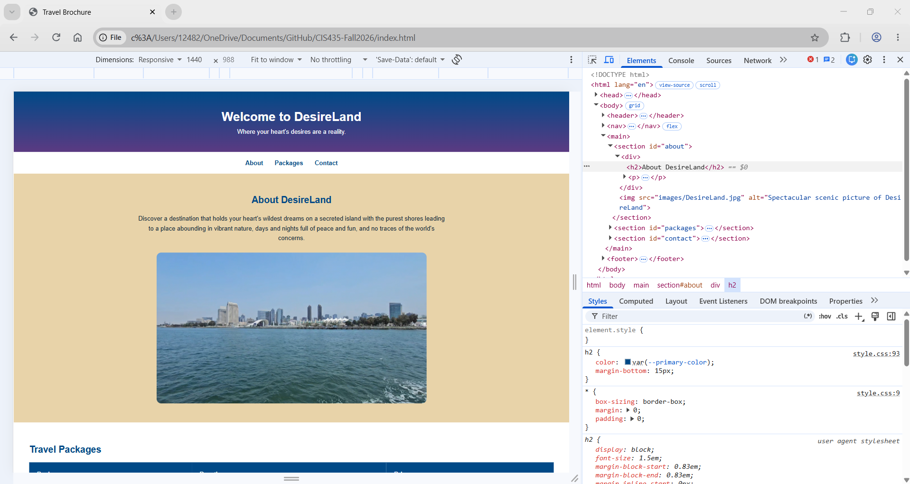
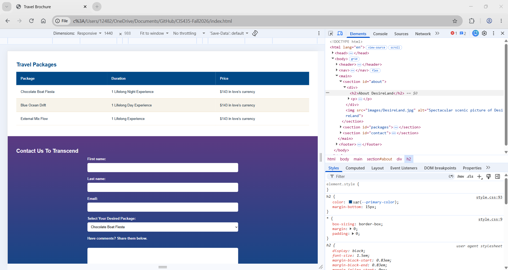
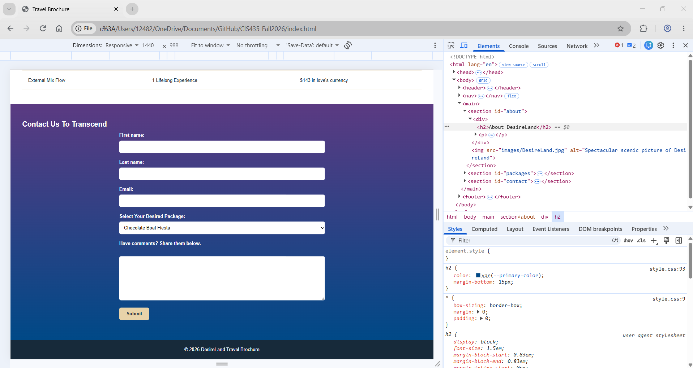
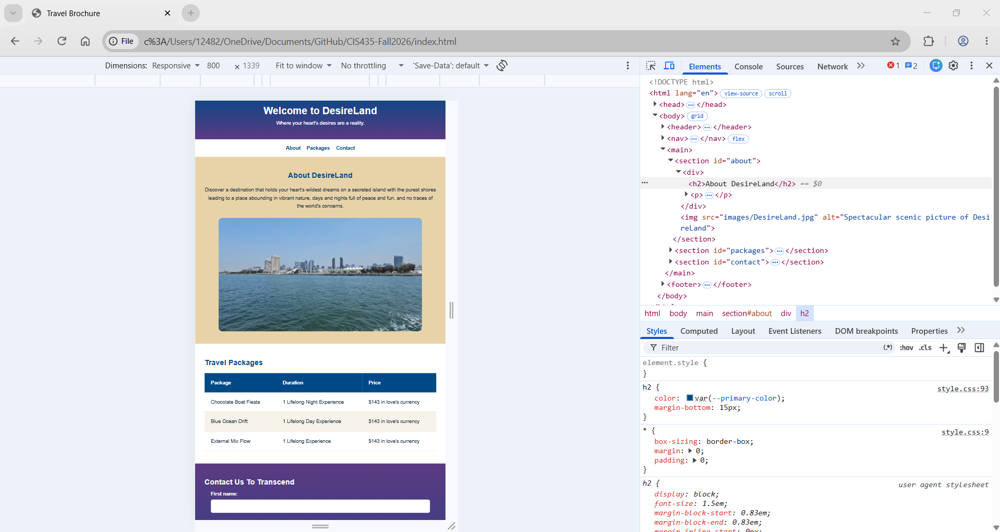
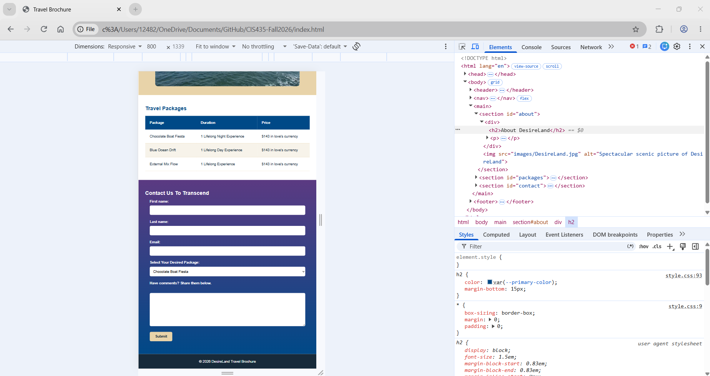
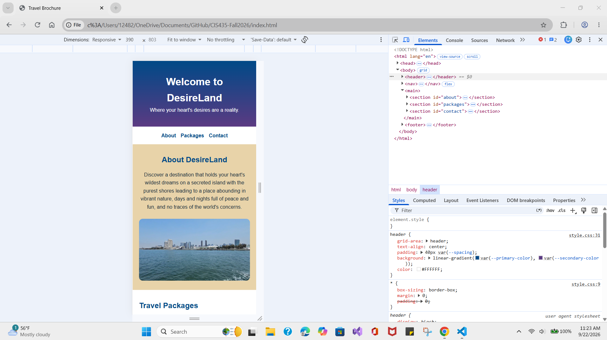
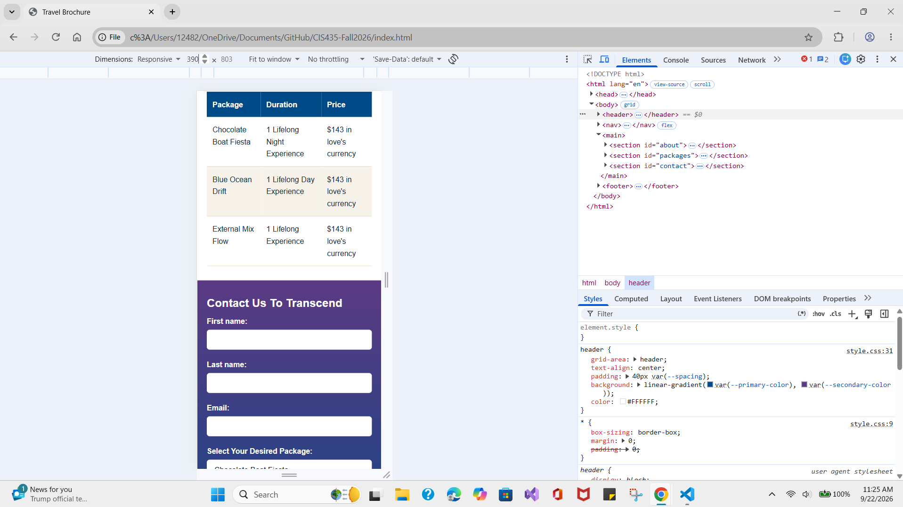
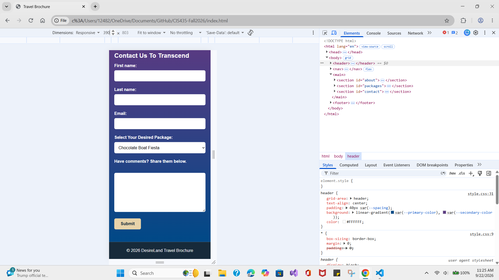

# CIS435-Fall2026

# CIS 435 - Fall 2026

## DesireLand Travel Brochure

This project is a travel brochure website for CIS 435.

### Destination

**DesireLand**

*"Where your heart's desires are a reality."*

DesireLand is a fictional island destination featuring scenic views, travel packages, and a contact form for visitors interested in experiencing the destination.

### Website Features Include:

- Semantic HTML structure
- Responsive navigation
- About DesireLand section
- Responsive scenic image
- Travel package table
- Contact form
- Responsive layouts for desktop, tablet, and mobile devices
- CSS gradients and custom color variables
- Hover effects on interactive elements

### Screenshots of website on different widths:

#### Desktop (1440 px)

#### Tablet (800 px)

#### Mobile (390 px)

